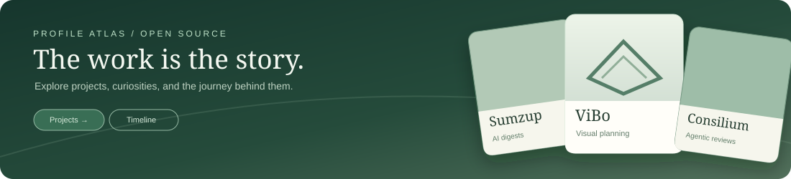

# Ava Kim

Software Engineer · AI Researcher · Independent Founder

I build products, research systems, and the tools that help build the next one. One experiment at a time.

**[Explore my interactive project gallery ↗](https://profile-atlas-showcase.wldud5192.chatgpt.site)** · [All projects](https://profile-atlas-showcase.wldud5192.chatgpt.site#work) · [Stories & inspiration](https://profile-atlas-showcase.wldud5192.chatgpt.site#journey) · [Portfolio](https://ava.kim)

### Currently building

| Product | What it does |
| --- | --- |
| **[ViBo](https://vibomaker.com)** | Visual workspaces for bringing ideas to life |
| **[Sumzup](https://sumz-up.com)** | Structured AI digests for long-form ideas |
| **[Consilium](https://consilium.ava.kim)** | Agentic roundtables for reviewing specs and software |
| **[SSMT](https://ssmt.uk)** | Discover products, papers, makers, and evidence |

**[Browse all public GitHub projects, stars & forks →](https://profile-atlas-showcase.wldud5192.chatgpt.site)**

The gallery includes a searchable one-line project index, a 2.5D slider, optional live demos, and a chronological activity timeline. My stories and visual inspiration have their own sliding rows.

---

[ava.kim](https://ava.kim) · [LinkedIn](https://www.linkedin.com/in/ava-ji-young-kim/) · [Instagram](https://www.instagram.com/fitness.in.v/) · [Previous README archive](PROFILE_ARCHIVE_2026.md)

*Enjoy the journey. Trust the process.*
