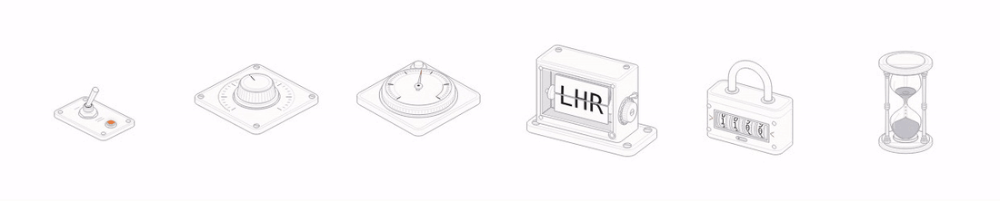
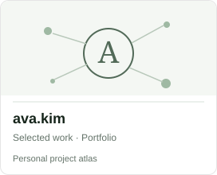
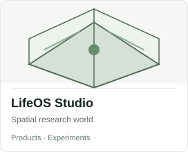

# Ava Kim

Software engineer · AI researcher · independent builder  
Sydney, Australia

I make things to find out what could be possible — useful software, creative tools, and experiments at the edges of AI and engineering.

I'm trying to build toward an R&D organisation that can give ambitious ideas the time, people, and resources to prove whether they can genuinely help.

<a href="https://profile.ava.kim/#activity"><picture><source media="(prefers-color-scheme: dark)" srcset="https://raw.githubusercontent.com/in-c0/my-prettier-github-profile-readme/output/activity-dark.svg"></picture></a>

3 months

<a href="https://profile.ava.kim/#activity"><picture><source media="(prefers-color-scheme: dark)" srcset="https://raw.githubusercontent.com/in-c0/my-prettier-github-profile-readme/output/activity-3m-dark.svg"></picture></a>

All time

<a href="https://profile.ava.kim/#activity"><picture><source media="(prefers-color-scheme: dark)" srcset="https://raw.githubusercontent.com/in-c0/my-prettier-github-profile-readme/output/activity-all-dark.svg"></picture></a>

<a href="https://profile.ava.kim/#coding-type"><picture><source media="(prefers-color-scheme: dark)" srcset="https://raw.githubusercontent.com/in-c0/my-prettier-github-profile-readme/output/coding-type-dark.svg"></picture></a>

<a href="https://profile.ava.kim/#curiosity"><picture><source media="(prefers-color-scheme: dark)" srcset="https://raw.githubusercontent.com/in-c0/my-prettier-github-profile-readme/output/curiosity-dark.svg"></picture></a>

**[Explore my work & activity](https://lifeos.studio/)** · [Personal site](https://ava.kim) · [LinkedIn](https://www.linkedin.com/in/ava-ji-young-kim/)

## Selected apps & experiments

Click a card to open the app or explore its source. Osteotype is the skeleton-typing game inside Typotyper.

<a href="https://ui.ava.kim/knurl/"><picture><source media="(prefers-color-scheme: dark)" srcset="assets/knurl-dark.gif"></picture></a>

**[Knurl](https://ui.ava.kim/knurl/)** — 28 accessible form controls drawn as working machines, for React or plain DOM. `npm i @in-c0/knurl`

<a href="https://ui.ava.kim/knurl/"><picture><source media="(prefers-color-scheme: dark)" srcset="https://raw.githubusercontent.com/in-c0/my-prettier-github-profile-readme/output/project-knurl-dark.svg"></picture></a>
<a href="https://typotyper.com/osteotype/"><picture><source media="(prefers-color-scheme: dark)" srcset="https://raw.githubusercontent.com/in-c0/my-prettier-github-profile-readme/output/project-typotyper-dark.svg"></picture></a>
<a href="https://vibomaker.com"><picture><source media="(prefers-color-scheme: dark)" srcset="https://raw.githubusercontent.com/in-c0/my-prettier-github-profile-readme/output/project-vibo-dark.svg"></picture></a>
<a href="https://ssmt.uk"><picture><source media="(prefers-color-scheme: dark)" srcset="https://raw.githubusercontent.com/in-c0/my-prettier-github-profile-readme/output/project-ssmt-dark.svg"></picture></a>
<a href="https://map.lifeos.studio"><picture><source media="(prefers-color-scheme: dark)" srcset="https://raw.githubusercontent.com/in-c0/my-prettier-github-profile-readme/output/project-sydney-environmental-atlas-dark.svg"></picture></a>
<a href="https://sumz-up.com"><picture><source media="(prefers-color-scheme: dark)" srcset="https://raw.githubusercontent.com/in-c0/my-prettier-github-profile-readme/output/project-sumzup-dark.svg"></picture></a>
<a href="https://marketplace.visualstudio.com/items?itemName=in-c0.daily-badge"><picture><source media="(prefers-color-scheme: dark)" srcset="https://raw.githubusercontent.com/in-c0/my-prettier-github-profile-readme/output/project-daily-badge-dark.svg"></picture></a>
<a href="https://github.com/in-c0/morse-code-game"><picture><source media="(prefers-color-scheme: dark)" srcset="https://raw.githubusercontent.com/in-c0/my-prettier-github-profile-readme/output/project-morse-code-typer-dark.svg"></picture></a>
<a href="https://spotify-lyrics-translator.netlify.app"><picture><source media="(prefers-color-scheme: dark)" srcset="https://raw.githubusercontent.com/in-c0/my-prettier-github-profile-readme/output/project-spotify-lyrics-translator-dark.svg"></picture></a>
<a href="https://chromewebstore.google.com/detail/youtube-shorts-playables/dilmoegnonbiadmhbmaehnhogjlkikdp"><picture><source media="(prefers-color-scheme: dark)" srcset="https://raw.githubusercontent.com/in-c0/my-prettier-github-profile-readme/output/project-shorts-remover-dark.svg"></picture></a>

## More tools, experiments & research

<a href="https://ui.ava.kim/paper-ui/"><picture><source media="(prefers-color-scheme: dark)" srcset="https://raw.githubusercontent.com/in-c0/my-prettier-github-profile-readme/output/project-paper-ui-dark.svg"></picture></a>
<a href="https://consilium.ava.kim"><picture><source media="(prefers-color-scheme: dark)" srcset="https://raw.githubusercontent.com/in-c0/my-prettier-github-profile-readme/output/project-consilium-dark.svg"></picture></a>
<a href="https://profile.ava.kim"><picture><source media="(prefers-color-scheme: dark)" srcset="https://raw.githubusercontent.com/in-c0/my-prettier-github-profile-readme/output/project-prettier-profile-dark.svg"></picture></a>
<a href="https://justtuned.com"><picture><source media="(prefers-color-scheme: dark)" srcset="https://raw.githubusercontent.com/in-c0/my-prettier-github-profile-readme/output/project-tuned-dark.svg"></picture></a>
<a href="https://physical-transformation-atlas.wldud5192.workers.dev"><picture><source media="(prefers-color-scheme: dark)" srcset="https://raw.githubusercontent.com/in-c0/my-prettier-github-profile-readme/output/project-physical-transformation-atlas-dark.svg"></picture></a>
<a href="https://in-c0.github.io/sydney-footfall/"><picture><source media="(prefers-color-scheme: dark)" srcset="https://raw.githubusercontent.com/in-c0/my-prettier-github-profile-readme/output/project-sydney-footfall-dark.svg"></picture></a>
<a href="https://in-c0.github.io/glassos-webgl/"><picture><source media="(prefers-color-scheme: dark)" srcset="https://raw.githubusercontent.com/in-c0/my-prettier-github-profile-readme/output/project-glassos-dark.svg"></picture></a>
<a href="https://in-c0.github.io/Fluid-Dynamics-Simulation/web/"><picture><source media="(prefers-color-scheme: dark)" srcset="https://raw.githubusercontent.com/in-c0/my-prettier-github-profile-readme/output/project-fluid-dynamics-dark.svg"></picture></a>
<a href="https://grakken-github-repo-analyser.vercel.app"><picture><source media="(prefers-color-scheme: dark)" srcset="https://raw.githubusercontent.com/in-c0/my-prettier-github-profile-readme/output/project-gitsum-dark.svg"></picture></a>
<a href="https://in-c0.github.io/Intro-to-AI/"><picture><source media="(prefers-color-scheme: dark)" srcset="https://raw.githubusercontent.com/in-c0/my-prettier-github-profile-readme/output/project-intro-to-ai-dark.svg"></picture></a>

Explore the broader work and public activity at [profile.ava.kim](https://profile.ava.kim).

## Collected along the way

<a href="https://profile.ava.kim/#collected"><picture><source media="(prefers-color-scheme: dark)" srcset="https://raw.githubusercontent.com/in-c0/my-prettier-github-profile-readme/output/collected-dark.svg"></picture></a>

## The questions that keep me going

- How can AI help us build *useful, reliable* things instead of just convincing prototypes?
- What would it take to make ambitious engineering and scientific research more accessible?
- How do we use new technology to expand people's health, dignity, independence, and opportunities?

Outside code, I love sports, creative projects, music, and learning alongside people who really care about what they're doing.

*Enjoy the journey. Trust the process.*

---

This README is the short introduction. The longer, more personal version I wrote previously is [here](https://lifeos.studio/). My projects and public activity are easier to explore at [profile.ava.kim](https://profile.ava.kim).

