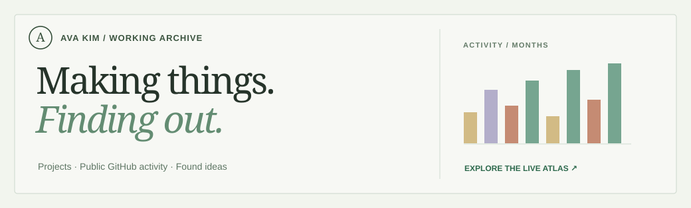

# Ava Kim

Software engineer · AI researcher · independent builder  
Sydney, Australia

I make things to find out what could be possible — useful software, creative tools, and experiments at the edges of AI and engineering.

I'm trying to build toward an R&D organisation that can give ambitious ideas the time, people, and resources to prove whether they can genuinely help.

**[Explore my work & activity](https://profile-atlas-showcase.wldud5192.chatgpt.site/)** · [Personal site](https://ava.kim) · [LinkedIn](https://www.linkedin.com/in/ava-ji-young-kim/)

## Things I've made

| Project | What it's for |
| :--- | :--- |
| [ViBo](https://vibomaker.com) | A visual workspace for thinking, planning, and exploring ideas. |
| [Sumzup](https://sumz-up.com) | Making long-form videos and ideas easier to understand and revisit. |
| [Consilium](https://consilium.ava.kim) | Agentic review of software, specifications, and visual quality. |
| [SSMT](https://ssmt.uk) | Discovering products, research, and the people building them. |
| [Paper UI](https://github.com/in-c0/paper-ui) | Expressive, reusable interface components. |
| [YouTube Shorts Remover](https://github.com/in-c0/youtube-shorts-remover) | A small browser utility that gives people more control over YouTube. |
| [YouTube to Text](https://youtubetotext.com) | Transcripts you can actually work with. |

There's more in the [interactive project gallery](https://profile-atlas-showcase.wldud5192.chatgpt.site/#work), including things I've starred and forked along the way.

## The questions that keep me going

- How can AI help us build *useful, reliable* things instead of just convincing prototypes?
- What would it take to make ambitious engineering and scientific research more accessible?
- How do we use new technology to expand people's health, dignity, independence, and opportunities?

Outside code, I love sports, creative projects, music, and learning alongside people who really care about what they're doing.

*Enjoy the journey. Trust the process.*

---

This README is the short introduction. The longer, more personal version I wrote previously is [preserved here](archive/profile-readme-2026-10-27.md). My projects and public activity are easier to explore in the [interactive showcase](https://profile-atlas-showcase.wldud5192.chatgpt.site/).